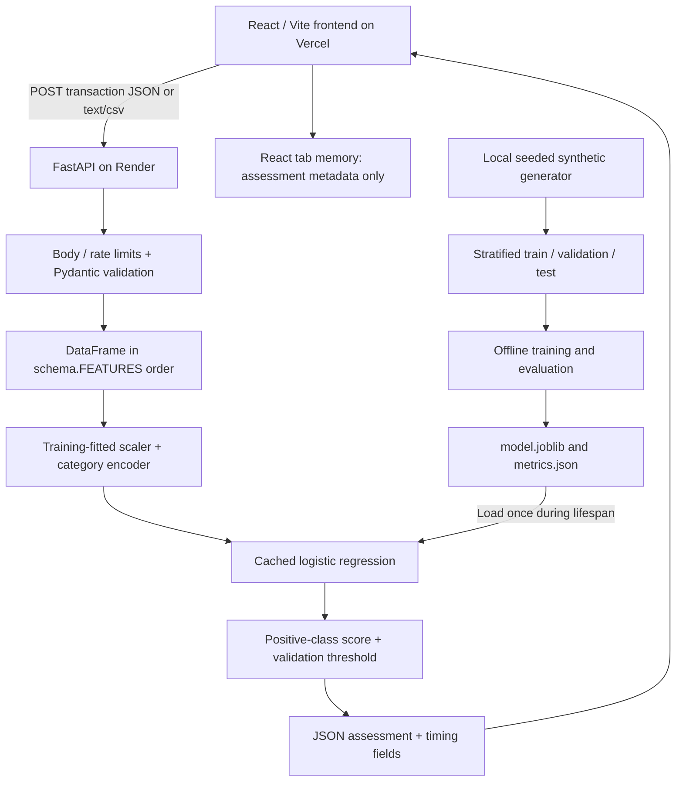

# SafePay AI — interview preparation

This guide explains the implementation in this repository. It does not establish who personally wrote each line. Before using resume wording, run the application, understand the code, and describe your own contributions accurately.

## A. Introduce the project

### 30-second explanation

“SafePay AI is a full-stack learning application for transaction risk analysis. A React dashboard submits eight fictional transaction signals to FastAPI. The API validates them and runs a saved scikit-learn preprocessing and logistic regression pipeline. It returns a review classification, model score, version, and timings. I can demonstrate single and batch analysis, evaluation metrics, and privacy-conscious API controls. Its major limitation is that it is trained on explicitly synthetic data, so it does not establish real-world fraud detection ability.”

### Two-minute explanation

“The problem is deciding which transactions deserve human review while balancing missed fraud and unnecessary alerts. This project lets me study that workflow end to end without processing private financial information.

“The frontend is React with Vite. The form contains amount, hour, recent transaction count, distance, account age, international status, new-device status, and merchant category. JavaScript converts numeric fields into numbers. FastAPI independently validates all fields with Pydantic, rejects unknown inputs and invalid ranges, and creates a DataFrame in the model's exact column order.

“An offline training command generates 16,000 fictional records and stochastic labels. It uses a stratified 60/20/20 split. Numeric scaling and category encoding are fitted only on training data. Logistic regression uses balanced class weights. A threshold is selected on validation F1, and final metrics come from the untouched test set. Those metrics include precision, recall, F1, ROC-AUC, average precision, and a confusion matrix.

“The API loads the trusted saved pipeline once during startup. A missing or incompatible model makes readiness fail and prediction return 503, rather than inventing a score. Single and batch requests share vectorized inference. The UI displays results and timings and keeps at most 200 assessment records in tab memory. No database or account authentication is needed for this synthetic demonstration.

“I can explain the validation, CORS, body and row limits, rate limiter, safe logs, and deployment configuration. I would need representative licensed data, temporal evaluation, calibration, access controls, stronger abuse protection, and monitoring before considering real financial use.”

### Motivation, value, and limitations

The application demonstrates integration of ML, APIs, browser interfaces, security controls, testing, and performance measurement. It is useful as an educational prototype and technical demonstration. It does not move money, certify transactions safe, replace banks, or identify criminal behavior.

Current limitations: synthetic data and simulator bias; moderate baseline test performance; no calibration or temporal validation; simple descriptive conditions rather than model explanations; no persistent history or authentication; per-process rate limiting; cloud deployment not verified. Future work must be described as future work.

## B. Architecture and request flow

Render and Vercel are prepared deployment targets, not confirmed live services. There is no database.

1. A form submit in `frontend/src/App.jsx` converts numbers and calls `predict`.
2. `frontend/src/api.js` sends JSON to the configured API base URL, starts a browser timer, and applies a 60-second timeout.
3. `backend/app/main.py` bounds the streamed body and applies POST rate limits.
4. FastAPI uses `Transaction` in `backend/app/schema.py` to reject missing, extra, malformed, unsupported, nonfinite, and out-of-range values.
5. `ModelService.predict` builds one DataFrame in `FEATURES` order. Column ordering never depends on JSON key order.
6. The saved `ColumnTransformer` applies the same fitted transformations used during training. The saved classifier computes scores.
7. A score at or above the validation-selected threshold maps to `fraud`; the UI calls this a review alert.
8. The response carries scores, model version, synthetic-data label, message, descriptive indicators, and preprocessing/inference/pipeline timings.
9. The browser adds round-trip and approximate overhead measurements. It displays success or a clear error.
10. At most 200 assessment records stay in React memory. Refresh clears them; submitted input values are not saved in history.

### Important files

| File/folder | Role |
| --- | --- |
| `backend/ml/train.py` | Synthetic data, stratified splits, fitted pipeline, threshold selection, metrics, artifacts |
| `backend/app/schema.py` | Single source of truth for model feature names/order and server input bounds |
| `backend/app/model.py` | Artifact loading checks; DataFrame preparation; shared single/batch inference |
| `backend/app/main.py` | Startup lifecycle, routes, errors, limits, CORS, timing/logging |
| `backend/artifacts/` | Locally generated model and metrics; ignored by Git; regenerated during Render build |
| `backend/tests/test_api.py` | API and real-model regression tests using a temporary trained artifact |
| `backend/benchmark.py` | Reproducible controlled latency comparisons and optional real HTTP test |
| `backend/requirements*.txt` | Runtime and development dependency pins |
| `frontend/src/App.jsx` | Dashboard, analysis, session history, metrics, health, model/about/help |
| `frontend/src/api.js` | Fetch wrapper, configured URL, timeout, errors, timing |
| `frontend/src/RiskDistribution.jsx` | Lazy-loaded score distribution chart |
| `frontend/src/styles.css` | Responsive ChaiUI dark/light theme, keyboard focus, reduced-motion rules |
| `frontend/src/*.test.*` | Form integration and API transport tests |
| `frontend/package-lock.json` | Resolved frontend dependencies for `npm ci` |
| `render.yaml` | Root-based Python build, offline training, Uvicorn start, health check |
| `frontend/vercel.json` | Vite build output and browser security headers |
| `.env.example` | Placeholder configuration; never secrets |
| `README.md` | Setup, schema, API, deployment, scope and troubleshooting |
| `PERFORMANCE.md` | Measurements and exact interpretation |
| `PROJECT_AUDIT.md` | Initial state and staged implementation verification |

### Endpoints

`GET /health` checks model readiness (200/503). `GET /api/model` exposes the loaded artifact's metadata, schema, threshold, and evaluation. `POST /api/predict` handles one JSON transaction. `POST /api/predict/batch` handles up to 100 JSON records. `POST /api/predict/csv` parses raw UTF-8 CSV with exact headers and up to 100 records. `/docs` and `/openapi.json` describe the API. No history API exists because the backend stores no history.

## C. Machine learning

### Data provenance and features

The source is `generate_data` in this repository, seed 42, not a bank dataset. Public ULB data was considered but not downloaded or integrated. There is no claim that local generated data is PaySim or that it represents real fraud.

The eight inputs are `amount`, `hour`, `transactions_24h`, `distance_km`, `account_age_days`, `international`, `new_device`, and `merchant_category`. Five numeric fields are standardized, two booleans pass through, and the category is one-hot encoded into five categories. The resulting classifier input has 12 columns. The binary target is a synthetic label sampled from a logistic risk function. It is never a feature.

The simulator deliberately makes some conditions more associated with positive labels. Therefore the project partly learns the assumptions built into the generator. Labels overlap; the UI does not simply apply the generator's rules as predictions. Inference runs the fitted classifier.

### Splits and leakage

16,000 records become 9,600 train, 3,200 validation, and 3,200 test. Both splits are stratified so class proportions remain similar. Scaling and encoding are fitted on training data only. The threshold maximizes validation F1 over a predefined 0.10–0.90 grid in 0.01 steps. The test set is evaluated only after training and threshold selection.

Because records are independently generated, random stratification is reasonable for this demonstration. Real transactions need chronological evaluation, customer/group considerations, realistic feature availability, and leakage checks. Do not claim temporal validation here.

### Why logistic regression?

It is fast, understandable, has a small artifact, and provides a natural positive-class score. Balanced class weights raise the penalty for mistakes in the minority class. This is a baseline choice, not a proven best model. Its linear decision function cannot express every interaction or nonlinear effect in the generator. Adding model complexity would require validation evidence and an operational reason.

### Metrics

- Precision = TP / (TP + FP): how many review alerts match the synthetic fraud label?
- Recall = TP / (TP + FN): how much labeled fraud did the model catch?
- F1 = harmonic mean of precision and recall: a threshold-dependent balance, not a complete business-cost measure.
- Confusion matrix: TN, FP, FN, TP as `[[TN,FP],[FN,TP]]` in this implementation.
- ROC-AUC: ranking quality across thresholds using true-positive and false-positive rates; can look reassuring when negatives dominate.
- Average precision (AP): a summary of the precision-recall curve, useful with imbalance. It is not the same numerical calculation as trapezoidal PR-AUC.
- Accuracy alone can reward predicting the majority class on almost every record.

Observed full-model synthetic test results: precision 0.3632, recall 0.4667, F1 0.4085, ROC-AUC 0.7849, AP 0.4040, matrix `[[2600,270],[176,154]]`, threshold 0.68. The generated class fraction is 0.1031875. Treat the running artifact's `/api/model` response as authoritative. Test fixtures use a smaller generated dataset and can have different metrics.

A false positive consumes investigation effort; a false negative misses a labeled fraud case. The current threshold uses F1, not a financial cost function. Neither the threshold nor these synthetic metrics should be copied into real risk decisions.

### Scores, uncertainty, overfitting, generalization

Logistic regression maps its fitted weighted sum through the sigmoid function. `predict_proba` returns class scores in `classes_` order; startup checks ensure `[0,1]`. Balanced training weights change the effective class distribution, so scores are not calibrated population probabilities. No Platt scaling, isotonic calibration, or real-data reliability study has been performed.

Overfitting means fitting training peculiarities rather than transferable patterns. A held-out split helps detect it within the simulated distribution; it cannot prove generalization to banks, different populations, or future time periods. Drift, fraud adaptation, labeling error, class prevalence, and biased synthetic assumptions remain major limitations.

## D. Cybersecurity

Implemented controls: strict server schemas; finite numeric values; known categories; unexpected fields rejected; 128 KiB streamed body cap; 100-row batch cap; per-process POST rate limits with a bounded client map; explicit browser origins; safe errors without input echoes or server paths; request IDs and timing logs; no server transaction persistence; security headers; trusted locally generated artifacts; pinned dependencies and advisory checks.

CSV parsing accepts raw `text/csv` and exact header order. It never opens spreadsheets or executes formulas. Formula-like numeric inputs fail validation. Only a fixed template is downloadable; exporting arbitrary user values is not implemented. Any future user-controlled CSV export needs formula-injection escaping.

Threats include abusive requests, oversized/chunked uploads, malformed types, unwanted browser origins, leaking request values in logs, malicious model deserialization, exposed credentials, and unreviewed dependency vulnerabilities. CORS is not authentication. The demo is public/stateless; it has no private history requiring authorization today. If that changes, authentication and per-user authorization become required.

Not implemented: distributed rate limiting, trusted-proxy-aware client attribution, full authentication, database encryption/access policies, global inference concurrency limits, end-to-end gateway timeout policies, penetration testing, production monitoring, drift/fairness audits, or regulatory compliance verification. Render clients may share a direct proxy address and therefore a rate quota. HTTPS is provided by intended hosts, not by the local Uvicorn command.

## E. Full-stack and deployment

React holds form state. On submit, `fetch` sends a POST body encoded as JSON. The API returns structured JSON with an HTTP status describing success or failure. Browser errors and server validation errors are displayed separately from a score. No score is substituted on failure.

Render build installs runtime requirements and trains the seeded baseline offline. Uvicorn binds `0.0.0.0:$PORT`, with one worker, no proxy headers, and no access log. The app uses source-relative artifact paths, not the shell's current folder for artifact lookup. Missing artifacts fail readiness without training inside a request.

Vercel builds `frontend/` with Vite. `VITE_API_BASE_URL` is a public build-time value: changing it requires redeployment. Backend origins are configured separately with `CORS_ORIGINS`. No localhost fallback exists in a production frontend build. In-page navigation needs no route rewrites. The configured CSP permits API calls to Render HTTPS hosts; adjust it for a custom backend domain.

Cold starts can include waking the host, starting Python, importing libraries, and loading the artifact. Startup caching prevents repeat loads after readiness, but cannot remove hosting sleep. The 60-second browser timeout is a user-experience bound, not a promise of availability. Check `/health`, model version, request ID, and safe timing logs when debugging.

No Render/Vercel account actions were completed. The README gives the exact remaining steps. Do not describe deployment configuration as an already deployed application.

## F. Performance

There was no earlier application to benchmark. Measurements compare deliberately constructed alternatives with the implemented inference path. They do not establish a historical production improvement.

The measured repeated work is preprocessing/model loading. Per-record Pandas and `ColumnTransformer` overhead dominates classifier arithmetic for this small model. Loading the artifact once avoids repeated deserialization. Vectorized batches perform preprocessing once for up to 100 records, producing equivalent scores within 1e-12. No feature transformations or classifier behavior were approximated.

Initial local controlled measurements: model reloaded per call 6.86 ms median vs cached 4.59 ms; 100 individual calls 460.43 ms vs one vectorized batch 4.83 ms. See PERFORMANCE.md for final rerun values, percentiles, sample counts, and conditions. Warm disk cache is not a hosting cold-start measurement.

Browser round-trip time includes fetch, transport, server work, and response parsing. Server header timing includes bounded body reception but excludes final network transmission. Their difference is transport/browser overhead, not pure network latency. Preprocessing and classifier timing are separately measured with `perf_counter`.

Trade-offs: a small CPU model is inexpensive and fast, but a simple model and synthetic data limit detection quality. Bigger infrastructure does not fix dataset validity. Lazy chart loading reduces initial JavaScript transfer without changing the user interface.

## G. Project-specific interview questions

### 1. Why is this useful when banks already detect fraud?
Banks already have much richer systems. This project teaches me to connect validation, a real model, APIs, security controls, and a usable investigation interface. Its value is demonstrable engineering and honest evaluation, not replacing a bank.
**Follow-up:** What is missing? Representative data, realistic labels, temporal evaluation, integrations, access control, and operational monitoring.

### 2. Is your dataset real?
No. `generate_data` produces fictional records with a fixed seed and stochastic labels. The UI and metrics explicitly say synthetic.
**Follow-up:** Why use it? It permits reproducible, privacy-conscious development; it cannot validate real-world effectiveness.

### 3. Are predictions hardcoded?
No. The offline command fits a classifier. Requests use the saved transformations and `predict_proba`, then compare the score to the saved threshold.
**Follow-up:** What is predefined? The synthetic data generator, schema, and descriptive indicator messages; these are not returned prediction scores.

### 4. What does supervised learning mean here?
The training records have input features and a known synthetic target label. The algorithm learns parameters linking inputs to that label.
**Follow-up:** Is this unsupervised anomaly detection? No; an unsupervised detector would learn unusual patterns without these supervised labels.

### 5. Why logistic regression?
It is a small, fast, understandable binary-classification baseline that returns positive-class scores.
**Follow-up:** Why not a random forest? That would need validation evidence; model complexity is not automatically better.

### 6. What exactly are your features?
Amount, hour, 24-hour count, distance, account age, international flag, new-device flag, and merchant category. They contain no card number or customer identifier.
**Follow-up:** Who supplies them? The fictional demo form; a real system would need trustworthy server-side signal collection.

### 7. How do you prevent training/inference mismatch?
The saved pipeline contains preprocessing and classifier. Training and serving use the same `FEATURES` order, and startup checks the fitted feature names and library version.
**Follow-up:** Does JSON order matter? No; DataFrame columns are explicitly ordered.

### 8. What is one-hot encoding?
It creates one binary column per merchant category so categories do not imply a numerical ranking.
**Follow-up:** What about a new category? Pydantic rejects unsupported categories, and the encoder also errors rather than guessing.

### 9. Why scale numeric inputs?
Amount, distance, hour, and age have different scales. `StandardScaler` centers/scales using training statistics, improving optimization and regularization behavior.
**Follow-up:** Do you fit the scaler per request? No; inference only calls its fitted transform.

### 10. How did you split the data?
Stratified 60% train, 20% validation, 20% test, using fixed random seeds.
**Follow-up:** Why not time-based? Records are independently simulated. Real transaction chronology would require temporal evaluation.

### 11. What is data leakage?
It is information unavailable at prediction time influencing training or evaluation. For example, fitting scaling on all data or tuning a threshold on test results leaks evaluation information.
**Follow-up:** What prevents it here? Train-only pipeline fitting and validation-only threshold selection.

### 12. How is class imbalance handled?
The generator produces fewer fraud labels. Stratification preserves proportions and `class_weight="balanced"` gives the minority class more weight.
**Follow-up:** Does that fix probabilities? No; it changes effective class priors and calibration must be evaluated separately.

### 13. Why is accuracy insufficient?
A majority-only predictor can look accurate while finding no fraud. Precision, recall, F1, AP, ROC-AUC, and the confusion matrix reveal different weaknesses.
**Follow-up:** Which matters most? That depends on investigation capacity and the costs of false positives and false negatives.

### 14. Explain precision and recall with this model.
Precision is the fraction of review alerts matching synthetic fraud labels. Recall is the fraction of labeled fraud cases that were alerted.
**Follow-up:** Can you maximize both automatically? Usually there is a threshold trade-off; better data and modeling may improve the curve.

### 15. What does the confusion matrix mean?
`[[2600,270],[176,154]]` means 2,600 true negatives, 270 false positives, 176 false negatives, and 154 true positives on the full synthetic test split.
**Follow-up:** Is that production evidence? No; it is only evaluation within this simulator.

### 16. How was the decision threshold chosen?
A predefined threshold grid is evaluated on validation F1, and the best threshold is saved. The full artifact used 0.68.
**Follow-up:** Why not always 0.5? The default cutoff need not match the desired precision/recall balance.

### 17. What is ROC-AUC versus AP?
ROC-AUC summarizes ranking by true/false positive rates. AP summarizes precision over recall changes and is useful for imbalanced positive detection.
**Follow-up:** Is AP identical to trapezoidal PR-AUC? No, the integration conventions differ; the API reports `average_precision` explicitly.

### 18. Does a 90% risk score mean 90% real fraud probability?
No. It is a class-weighted classifier output on synthetic data, with no post-training calibration or real-population validation.
**Follow-up:** How could you improve probability interpretation? Use representative held-out calibration data and reliability evaluation, without using the final test set to tune.

### 19. Are the displayed indicators explanations?
They describe submitted flags or counts, such as a new device. They are not feature-attribution calculations or causal explanations.
**Follow-up:** Why avoid stronger claims? A condition being present does not prove it caused the score or a fraudulent outcome.

### 20. What is overfitting?
Learning quirks that do not transfer beyond training data. Separate validation/test splits help detect it within the simulated distribution.
**Follow-up:** Can high synthetic test performance prove generalization? No; real data can differ radically.

### 21. What happens during application startup?
FastAPI lifespan loads the trusted artifact once and verifies schema, class order, dataset kind, and scikit-learn version. Readiness reflects success.
**Follow-up:** What if loading fails? `/health` and predictions return 503; prediction requests never trigger training.

### 22. Why use Pydantic if the browser already validates?
Clients can bypass the browser. Pydantic enforces server-side types, finite values, ranges, required fields, known categories, and rejection of extra fields.
**Follow-up:** Why strict types? It avoids ambiguous coercions such as the string `"false"` in JSON flags.

### 23. How are CSV batches protected?
The body is capped at 128 KiB, headers must match the ordered schema, rows are capped at 100, types are explicitly parsed, and every row passes the same transaction validation.
**Follow-up:** Is the file saved? No, it is parsed in memory and discarded after the response.

### 24. Which HTTP methods and errors do you use?
GET reads readiness/metadata. POST performs analysis. The API uses 422 validation, 413 size, 415 media type, 429 quota, 503 model unavailable, and safe 500 errors.
**Follow-up:** Why not return a default score on error? It would present fabricated inference as a real assessment.

### 25. How does React talk to Python?
`api.js` uses fetch with the environment-configured API origin. It sends JSON or raw CSV and parses the JSON response.
**Follow-up:** Is `VITE_API_BASE_URL` secret? No; it is embedded in browser assets and must contain only a public service URL.

### 26. What does CORS protect?
It limits which browser origins may read API responses. Allowed origins are explicit and a wildcard is rejected.
**Follow-up:** Does CORS stop curl or authenticate users? No. Authorization needs separate controls if private data is introduced.

### 27. Where are transactions stored?
The API stores none. React holds the latest 200 assessment metadata records in tab memory. Refresh clears them.
**Follow-up:** Why not SQLite? There is no current durable-history requirement, and ephemeral hosting storage would add misleading persistence and privacy complexity.

### 28. Why is there no login?
This is a stateless synthetic demonstration with no private user data or saved server history. Authentication is a future requirement if that scope changes.
**Follow-up:** What would authorization protect? Each user's records and administrative actions; authentication alone does not enforce ownership.

### 29. How do you avoid sensitive logs?
Application logs contain request IDs, status, method, counts, and timings; errors omit payload values. The documented Uvicorn command disables access logs, which could include query strings.
**Follow-up:** Are hosting provider logs covered? Provider-level logging must also be reviewed before accepting sensitive traffic.

### 30. What are the rate limiter's limitations?
It is bounded, in memory, per process, and applies to POSTs by direct client address. It resets on restart and does not coordinate across workers.
**Follow-up:** What happens behind Render's proxy? Clients may share one quota. A trusted gateway or centralized limiter is needed for reliable per-user production limits.

### 31. How did you measure latency?
`perf_counter` surrounds preprocessing and inference, middleware measures server processing, and the browser measures fetch through response parsing. The benchmark measures controlled alternatives and optional localhost HTTP.
**Follow-up:** Is browser minus server pure network latency? No; it also includes browser/client work and excluded server transmission.

### 32. What was optimized?
Startup caching avoids repeated model deserialization; vectorized batches avoid repeating DataFrame and transformation work per row; chart code loads lazily.
**Follow-up:** Did scores change? Regression checks compare shared inference, individual/batch results, and the saved pipeline within 1e-12.

### 33. How is synchronous ML handled in an async API?
The inference call runs in Starlette's threadpool so the async event loop is not directly occupied by synchronous preprocessing/model work.
**Follow-up:** Does a threadpool guarantee unlimited throughput? No; CPU, thread capacity, concurrency, and deployment limits still matter.

### 34. How are Render and Vercel configured?
Render installs Python dependencies, trains offline at build, and runs Uvicorn on `$PORT`. Vercel builds `frontend/`, embeds the API URL, and serves `dist` with security headers.
**Follow-up:** Is it already deployed? No; account setup, repository connection, real domain configuration, and remote verification remain.

### 35. What causes cold starts?
A host can sleep; waking requires process startup, imports, and model loading. Caching helps subsequent requests but cannot prevent platform sleep.
**Follow-up:** How does the UI respond? It shows loading, uses a 60-second request timeout, and suggests checking health and retrying.

### 36. How do tests prove the model is actually used?
Backend tests train a real temporary artifact and compare API scores directly with the saved pipeline's `predict_proba`. They test failures, limits, CORS, batch equivalence, and concurrency too.
**Follow-up:** Are frontend mocks enough? No. Unit tests isolate transport, while a separate real-browser check verifies the local frontend-to-API flow.

### 37. What is dangerous about joblib files?
Loading a serialized Python object can execute code. Only artifacts generated by the trusted offline build are loaded; users cannot upload models.
**Follow-up:** Is a filename extension enough to establish trust? No; provenance and controlled build/release processes matter.

### 38. How would you debug a prediction mismatch after deployment?
Compare model version, dependency versions, exact input values, schema order, threshold, and fitted pipeline. Confirm both services use the intended artifact and deployment configuration.
**Follow-up:** Could displayed rounding explain it? It can explain small visual differences; compare raw scores before blaming the classifier.

### 39. What are your first real-data improvements?
Obtain licensed representative data, use prediction-time-available signals, split chronologically and by relevant groups, evaluate costs/calibration, and test drift and fairness.
**Follow-up:** Would you reuse this schema unchanged? Only if it genuinely matches the new data; anonymized public columns cannot be relabeled as these signals.

### 40. What can you truthfully claim about security?
Specific implemented controls and passing tests. I cannot claim production security, regulatory compliance, or protection from every attack.
**Follow-up:** What does a clean dependency audit mean? No advisories found for resolved versions by that database at check time; it is not a penetration test or guarantee.

## H. Resume, README, and demonstration

### Resume wording to adapt after understanding your contributions

“SafePay AI — React, FastAPI, scikit-learn: implemented a synthetic-data transaction risk demo with a saved preprocessing/classification pipeline, validated single and batch inference, session analytics, API protection controls, automated tests, and Render/Vercel deployment configuration.”

Only use “implemented” for work you can explain and honestly attribute. Do not add real-world accuracy, production deployment, bank adoption, personal authorship, or unsupported latency improvements. Refer to controlled local benchmarks with their conditions if discussing performance.

### Concise GitHub description

“Educational fraud risk dashboard using React/Vite, FastAPI, and logistic regression trained on explicitly synthetic data. Includes strict API validation, CSV batches, session-only history, held-out metrics, timing instrumentation, automated tests, and hosting configuration. Not validated for real financial decisions.”

README.md is the complete runnable GitHub README; keep its quick start, scope, and verification evidence with the repository.

### Three-minute live demonstration

**0:00–0:25:** Show the dashboard. Explain that it starts with zero session transactions and uses a synthetic model. Point out readiness.

**0:25–1:05:** Open Analyze transaction, submit fictional defaults, and show the actual score and threshold. Explain that a below-threshold result does not guarantee safety. Identify preprocessing, inference, and round-trip timings.

**1:05–1:35:** Change amount, hour, recent count, distance, and flags using fictional values. Submit again; explain the model output without promising a preselected classification. Describe indicators as reported conditions.

**1:35–2:00:** Download the CSV template and upload it, or use already prepared fictional data. Show that batch responses enter session history. Search/filter/sort a record and open details.

**2:00–2:30:** Open Analytics. Explain precision vs recall and one false-positive/false-negative count from the actual confusion matrix. State that the metrics are synthetic and the baseline has limitations.

**2:30–3:00:** Show About the model and System health. Explain offline training, startup loading, no private data storage, API tests, and deployment configuration. Finish with the first real-data improvement you would make.

### Demo troubleshooting checklist

1. Before the demonstration, run training, start the backend, check `/health`, start Vite, and confirm the API URL/origin.
2. If the model is unavailable, verify the artifact directory and installed scikit-learn version, retrain, and restart. Do not substitute a mock score.
3. If a request fails, inspect browser-visible error text, backend readiness, CORS, protocol, port, and safe request logs.
4. If a host is waking, wait and retry; distinguish cold starts from model inference time.
5. If CSV fails, use the template, exact columns/order, finite numbers, integer fields, true/false flags, and supported categories.
6. If limited with 429, wait a minute and stop repeated submissions. Shared proxy quotas are a documented limitation.
7. If production configuration changes, redeploy Vite after updating its build-time API URL and restart the backend after changing CORS.
8. If history disappears, explain that it is intentionally tab memory. Reanalyze fictional examples.
9. If a chart or external font is unavailable, the score and API remain the primary demonstration. System font fallbacks preserve readability.
10. If deployment has not been completed, demonstrate locally and say so plainly.
