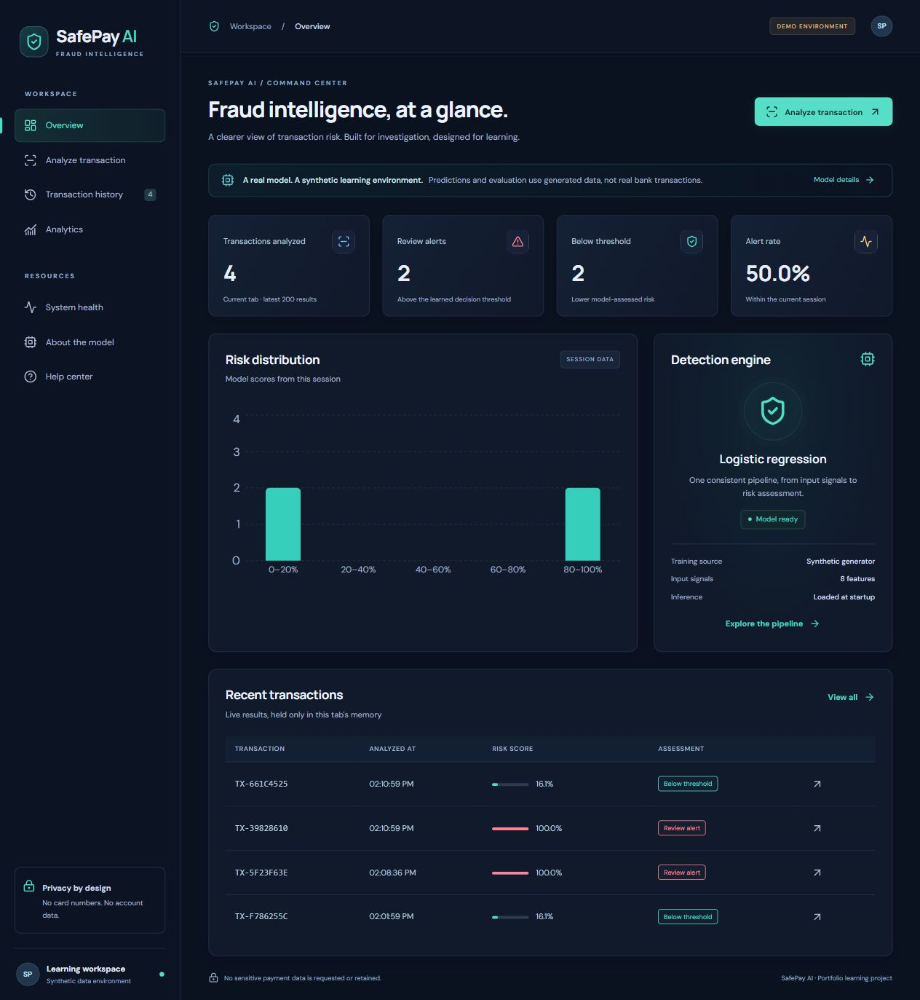
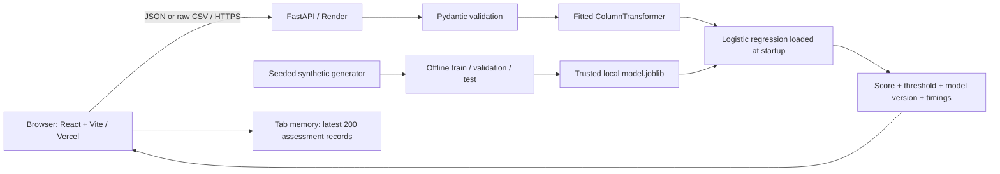

# SafePay AI

**AI-Powered Fraud Transaction Detection and Cybersecurity Analytics**

A React/Vite dashboard backed by FastAPI and an actual trained scikit-learn pipeline. Analyze fictional transactions individually or in CSV/JSON batches, inspect model scores and timings, and explore held-out evaluation metrics.

**Educational synthetic-data model only.** No real financial dataset was downloaded or used. All training records and labels come from the documented local generator. A fraud label means review is suggested by this simulator-trained model, not proof of criminal activity. Scores are not calibrated real-world probabilities. This application has not been deployed or certified secure/compliant.



## Quick start (Windows PowerShell)

Requires Python 3.11 and Node.js 24 (tested locally with Python 3.11.9 / Node 24.19.0). Run from the project root:

```powershell
python -m venv .venv
.\.venv\Scripts\python.exe -m pip install -r backend/requirements-dev.txt
.\.venv\Scripts\python.exe -m backend.ml.train
.\.venv\Scripts\python.exe -m uvicorn backend.app.main:app --host 127.0.0.1 --port 8000 --no-access-log
```

In another terminal:

```powershell
cd frontend
npm ci
npm run dev
```

Open http://127.0.0.1:5173. Backend health: http://127.0.0.1:8000/health. Interactive API documentation: http://127.0.0.1:8000/docs.

Open the HTTP address served by Vite to use the application. Opening `frontend/index.html` through a `file://` URL does not start React, Vite, or the backend. Use `npm run dev -- --port 5173 --strictPort` to fail clearly if the expected port is already occupied; a different port requires updating the allowed CORS origins.

Latest local re-verification and failure-path results: [LOCAL_VERIFICATION.md](LOCAL_VERIFICATION.md).

On macOS/Linux, replace `.\.venv\Scripts\python.exe` with `.venv/bin/python`. Run Python modules from the repository root. The repository includes the trusted synthetic baseline in `backend/artifacts/model.joblib` and `metrics.json`; other generated artifacts remain ignored. The training command reproduces the baseline; it is only necessary if the model is missing or incompatible, or you intentionally retrain. Restart the API after retraining. Training never occurs inside an API request. Never substitute an untrusted joblib file.

## Features

- Responsive dashboard with honest empty states and synthetic-data labels.
- Eight-field single analysis; raw CSV upload and JSON batch APIs (maximum 100 records).
- Real classifier scores, model version, descriptive input conditions, and timing breakdown.
- Session history with search, classification filters, risk/date sorting, pagination, and details. Latest 200 assessments live only in React memory and clear on refresh. No input payloads are retained in history.
- Score distributions, synthetic test metrics, confusion matrix, model documentation, help, and readiness status.
- Strict server-side schemas, bounded request bodies, bounded per-process rate limiting, explicit CORS origins, safe errors, and privacy-conscious logs.

## Architecture



No database, authentication, private account history, payment processing, or automated blocking is implemented.

## Project map

| Path | Purpose |
| --- | --- |
| `backend/app/schema.py` | Ordered feature contract, bounds, request/response schemas |
| `backend/ml/train.py` | Reproducible synthetic generation, splits, preprocessing, training, threshold selection, final evaluation |
| `backend/app/model.py` | Trusted artifact loading, compatibility checks, shared vectorized inference |
| `backend/app/main.py` | API lifecycle, validation, CSV parsing, limits, CORS, safe logs, health |
| `backend/tests/test_api.py` | Real-model API, security, failure, consistency, and concurrency tests |
| `backend/benchmark.py` | Controlled model-loading, batch, and optional localhost HTTP measurements |
| `frontend/src/App.jsx` | Navigation, dashboard, form, results, session history, model/help sections |
| `frontend/src/api.js` | Environment-based API URL, timeout, errors, browser/server timing |
| `frontend/src/RiskDistribution.jsx` | Lazy-loaded Recharts distribution visualization |
| `frontend/src/styles.css` | Dark responsive theme, focus states, reduced-motion support |
| `frontend/src/*.test.*` | API transport and form/result/error tests |
| `render.yaml`, `frontend/vercel.json` | Hosting configuration; not proof of deployment |
| `PERFORMANCE.md`, `PROJECT_AUDIT.md` | Measured performance and implementation verification |
| `INTERVIEW_PREPARATION.md` | Beginner-friendly explanation, questions, resume, demo |

## Feature contract

The following CSV header order is mandatory. JSON property order is irrelevant: inference explicitly reorders columns using the shared contract.

```csv
amount,hour,transactions_24h,distance_km,account_age_days,international,new_device,merchant_category
149.5,14,3,12,730,false,false,retail
4800,2,16,1800,12,true,true,transfer
```

These are fictional examples, not fixed expected classifications. The UI offers this template as a download.

| Field | Accepted values |
| --- | --- |
| amount | Finite number, 0.01–1,000,000 synthetic currency units |
| hour | Integer, 0–23 |
| transactions_24h | Integer, 1–100 |
| distance_km | Finite number, 0–20,000 |
| account_age_days | Integer, 0–7,300 |
| international / new_device | JSON boolean; CSV `true` / `false` (case-insensitive) |
| merchant_category | retail, grocery, travel, entertainment, transfer |

Unknown JSON fields, stringified JSON numbers, fractional integers, missing values, nonfinite numbers, unsupported categories, malformed CSV, extra columns, and incorrect CSV header order are rejected.

## API summary

| Method and route | Purpose / response |
| --- | --- |
| `GET /health` | 200 ready; 503 if artifact is missing, corrupt, or incompatible |
| `GET /api/model` | Actual artifact metadata, test metrics, threshold, feature list, input JSON schema; 503 without model |
| `POST /api/predict` | Transaction JSON → `{result, timings}` |
| `POST /api/predict/batch` | `{transactions: [...]}` → `{results, timings}` |
| `POST /api/predict/csv` | UTF-8 raw text with `Content-Type: text/csv` → `{results, timings}` |
| `GET /docs`, `/openapi.json` | Generated interactive API documentation / OpenAPI contract |

Each assessment contains `prediction` (`fraud` or `legitimate`), `risk_score`, `model_version`, `dataset_kind`, `message`, and descriptive `indicators`. A `fraud` classification is presented as a review alert in the UI. `timings` contains preprocessing, model inference, and pipeline duration in milliseconds. `X-Request-Time-Ms` and `Server-Timing` measure server processing including bounded body reception and before final transmission. Model loading happens before readiness, outside these measurements.

Errors use `{"error":{"code":"...","message":"..."}}`, with field names for schema errors. Status codes: 413 oversized, 415 incorrect CSV content type, 422 validation, 429 rate limit, 503 model unavailable, 500 safe unexpected error. The frontend cancels requests after 60 seconds and does not automatically retry predictions.

## ML methodology

`generate_data` creates 16,000 independent fictional transactions with seed 42. Numeric signals use lognormal, exponential, integer, and Poisson distributions; flags/categories are sampled. Labels are Bernoulli draws from a deliberately designed logistic risk function. This embeds assumptions into the data and cannot demonstrate real-world fraud detection.

Stratified random splits: 9,600 train, 3,200 validation, 3,200 test. The training-only `ColumnTransformer` standardizes five numeric fields, passes two booleans through, and one-hot encodes five merchant categories. Logistic regression uses balanced class weights. Threshold selection maximizes validation F1 on a predefined grid; test data is used only for final reporting. No calibration is performed. The generated fraud fraction is about 10.3%, unlike many real fraud datasets.

Actual local synthetic test metrics: precision 0.3632, recall 0.4667, F1 0.4085, ROC-AUC 0.7849, average precision 0.4040. Confusion matrix `[[2600,270],[176,154]]`, rows actual `[legitimate,fraud]`, columns predicted in the same order. Threshold 0.68. These are a baseline with substantial false positives and false negatives. Regenerate and consult `/api/model` for the artifact actually running; dependency/platform changes can affect results.

Public dataset considered: [ULB Credit Card Fraud Detection](https://www.kaggle.com/datasets/mlg-ulb/creditcardfraud). Its page was consulted, but no dataset was downloaded, verified, or incorporated in this implementation. Its anonymized feature schema cannot simply be substituted into this eight-signal model. The implemented fallback is the explicitly labeled local synthetic generator; no claim is made that public data was technically impossible to obtain.

## Tests, build, and benchmarks

```powershell
.\.venv\Scripts\python.exe -m pytest -q
.\.venv\Scripts\python.exe -m backend.benchmark
# Optional: start the API first; this makes real localhost HTTP requests.
.\.venv\Scripts\python.exe -m backend.benchmark --url http://127.0.0.1:8000
cd frontend
npm test
npm run build
npm audit
```

Backend dev dependencies include `pip-audit`; run `.venv\Scripts\python.exe -m pip_audit` from the project root. Advisory checks need network access. See PERFORMANCE.md for measured comparisons and limits. The backend test fixture trains a real smaller synthetic pipeline in a temporary directory; expected scores are compared with its saved pipeline, not hardcoded predictions. Frontend unit tests mock transport deliberately; actual browser-to-API verification is separate.

## Environment

Environment files are examples; the backend reads process environment and does **not** implicitly load `.env`. In PowerShell set `$env:CORS_ORIGINS="http://localhost:5173,http://127.0.0.1:5173"` before launching. Vite automatically reads `frontend/.env.local`.

| Variable | Used by | Meaning |
| --- | --- | --- |
| `CORS_ORIGINS` | API | Comma-separated explicit origins. Default local Vite origins. Wildcard rejected. No trailing slash. |
| `RATE_LIMIT_PER_MINUTE` | API | POST requests per client address per process, default 120 |
| `MODEL_DIR` | API | Optional artifact directory; defaults to source-relative `backend/artifacts` |
| `VITE_API_BASE_URL` | Frontend build | API origin. Local default in development only; production requires configuration. Public, never a secret. |
| `PORT` | Render start command | Platform-provided listening port |

## Deployment (account actions still required)

1. Use the GitHub repository [sumit0089/Fraud-Transaction-Detection](https://github.com/sumit0089/Fraud-Transaction-Detection). Cloud hosting accounts and deployments are not configured by connecting Git.
2. Render: create a Python Web Service from the repository root, or use `render.yaml`. Build: `pip install -r backend/requirements.txt && python -m backend.ml.train`. Start: `uvicorn backend.app.main:app --host 0.0.0.0 --port $PORT --workers 1 --no-proxy-headers --no-access-log`. Health check: `/health`. Runtime: Python 3.11.9 as configured. Training during build generates trusted artifacts; inference never trains or depends on a writable persistent filesystem.
3. Vercel: import the same repository with **Root Directory `frontend`**, framework Vite, build `npm run build`, output `dist`, Node 24. Set `VITE_API_BASE_URL=https://YOUR-SERVICE.onrender.com` and deploy.
4. Set Render `CORS_ORIGINS=https://YOUR-FRONTEND.vercel.app` and restart/redeploy the backend. Include additional origins only when needed. Preview subdomains are not automatically allowed.
5. Changing a Vite variable requires a new frontend build/deployment. For a custom backend hostname, update `connect-src` in `frontend/vercel.json` from the Render wildcard to that exact HTTPS origin. The default CSP allows HTTPS Render hosts, not localhost in production.
6. Verify the deployed `/health`, then submit the same fictional transaction locally and remotely with the same artifact/version and compare scores. Check a denied CORS origin and model version. Existing config files do not verify deployment.

Free-tier hosts may sleep, have cold starts, or change quotas. No deployed latency or availability promise is made. Keep one API worker for this demo. The rate limiter uses direct peer addresses and ignores forwarded headers to prevent spoofing; behind Render's proxy clients may share a limit. Use a trusted-proxy-aware gateway or centralized limiter before scaling.

The app uses in-page navigation without URL routes, so no SPA rewrites are required. Vercel adds CSP and other browser security headers. Hosts provide HTTPS; local development uses HTTP.

References consulted: [FastAPI lifespan](https://fastapi.tiangolo.com/advanced/events/), [scikit-learn evaluation](https://scikit-learn.org/stable/modules/model_evaluation.html), [Render FastAPI deployment](https://render.com/docs/deploy-fastapi), [Vite on Vercel](https://vercel.com/docs/frameworks/frontend/vite).

## Security scope

128 KiB body limit applies even without Content-Length; batch limit is 100 rows; unknown fields and invalid ranges are rejected. Per-process POST quotas and a 4,096-client bounded limiter constrain demo abuse. CORS controls browser reads, not authentication or non-browser requests. Errors omit submitted values, paths, and stack traces; logs contain request IDs, methods, counts, status, and durations. Use `--no-access-log` to avoid logging user-controlled query strings. CSV input is parsed in memory and never executed or written to disk. Only a fixed synthetic template is exported, so there is no user-controlled spreadsheet export requiring escaping today.

Artifacts are trusted executable serialization: never load user-supplied joblib files. Dependency pins, lockfile, and advisory checks reduce known-version risk, not every security risk. No accounts, database, server history, distributed rate limit, global inference concurrency cap, model drift monitoring, malware scanner, fairness audit, calibration, or compliance verification is implemented. Body upload deadlines and connection limits must be configured at the hosting gateway. Public deployment is for synthetic demonstrations only.

## Demo troubleshooting

- Model unavailable: run training with the installed requirements, verify `MODEL_DIR`, restart the API, inspect safe server logs.
- Connection failure: open `/health`, check ports, browser API URL, CORS origin, HTTPS/mixed content, and hosting cold start.
- Production URL missing: set `VITE_API_BASE_URL` in Vercel and redeploy.
- CSV rejected: download the template; preserve exact columns/order and use only finite numbers and `true`/`false` booleans.
- 429: stop repeated submissions, wait one minute; on a proxy, shared limits are possible.
- History disappeared: intentional tab-only storage; reanalyze fictional examples.
- Network sandbox prevents local socket access: run the local servers/tests in an approved terminal outside that sandbox; no security settings need to be disabled.
